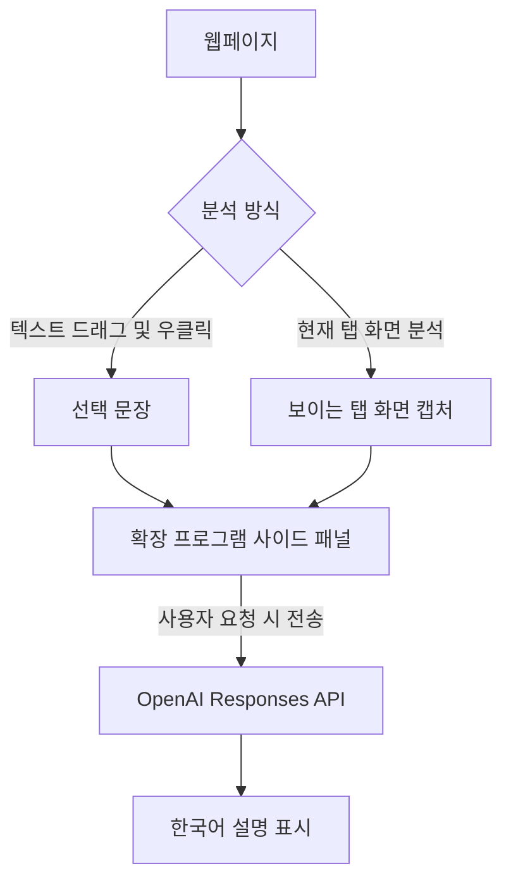

# AI 브라우저 설명 도우미

> Chrome / Microsoft Edge에서 **선택한 문장** 또는 **현재 웹 탭의 화면**을 OpenAI API로 설명하는 개인용 브라우저 확장 프로그램입니다.

   

## 주요 기능

- **선택 문장 설명**: 웹페이지에서 문장을 드래그하고 우클릭 → `AI로 선택 문장 설명`
- **현재 탭 화면 분석**: 페이지에서 우클릭 → `AI로 현재 탭 화면 설명` (보이는 영역만 캡처)
- **사이드 패널**: 브라우저 화면을 유지하면서 AI 답변 확인
- **추가 질문**: 분석 전 질문 입력 가능 (예: `중학생도 이해하게 설명해 줘`)
- **단축키 지원**: 기본 제안 단축키 `Ctrl + Shift + Y`로 확장 아이콘 동작 실행 (충돌 시 변경 가능)
- **모델명 설정**: OpenAI API 키와 사용할 모델명을 옵션 페이지에서 설정

> [!NOTE]
> 이 저장소는 **개인 테스트용 프로토타입**입니다. 실제 Chrome·Edge 환경에서의 종합 동작 테스트 및 스토어 심사는 완료되지 않았습니다.

## 작동 원리



이 확장 프로그램은 브라우저의 **Manifest V3**, `chrome.sidePanel`, `chrome.contextMenus`, `chrome.tabs.captureVisibleTab` 및 `chrome.scripting` 등을 사용합니다. 별도 Node.js 서버나 빌드 도구 없이 로컬 폴더를 직접 불러오는 구조입니다.

## 설치 방법

### 1. 파일 준비

이 저장소를 ZIP으로 내려받아 압축을 해제하거나 Git으로 복제합니다.

```bash
git clone https://github.com/<YOUR_USERNAME>/<YOUR_REPOSITORY>.git
```

> 위 주소의 `<YOUR_USERNAME>`과 `<YOUR_REPOSITORY>`를 본인의 GitHub 계정 및 저장소명으로 변경하세요.

### 2. 확장 프로그램 로드

**Chrome**

1. 주소창에서 `chrome://extensions` 열기
2. 오른쪽 상단 **개발자 모드** 켜기
3. **압축해제된 확장 프로그램을 로드** 클릭
4. `manifest.json` 파일이 있는 프로젝트 폴더 선택

**Microsoft Edge**

1. 주소창에서 `edge://extensions` 열기
2. **개발자 모드** 켜기
3. **압축 풀린 항목 로드** 등 해당 브라우저의 로드 메뉴 클릭
4. `manifest.json` 파일이 있는 프로젝트 폴더 선택

### 3. OpenAI API 키 설정

1. [OpenAI API 키 페이지](https://platform.openai.com/api-keys)에서 API 키 생성
2. 확장 프로그램 세부정보에서 **확장 프로그램 옵션**을 열거나 확장 프로그램의 옵션 화면으로 이동
3. 발급한 API 키 및 사용할 모델명을 입력하고 **저장**
4. API 결제·사용 한도 설정 확인

**주의:** ChatGPT 구독료와 OpenAI API 사용료는 별도입니다. 모델 이름은 API 계정에서 사용 가능한 **텍스트·이미지 입력 지원 모델**이어야 합니다. 초기 모델명은 코드에 `gpt-5.5`로 지정되어 있으며, API에서 접근할 수 없는 경우 옵션에서 변경해야 합니다.

## 사용 방법

### 선택 문장 설명

1. 웹사이트의 텍스트를 마우스로 드래그합니다.
2. 우클릭 → **AI로 선택 문장 설명** 선택
3. 브라우저 오른쪽에 사이드 패널이 열리면 필요에 따라 추가 질문 입력
4. **AI에게 설명 요청** 클릭

### 현재 탭 화면 분석

1. 분석할 웹페이지를 엽니다.
2. 우클릭 → **AI로 현재 탭 화면 설명** 선택
3. 사이드 패널에서 **AI에게 설명 요청** 클릭

또는 확장 아이콘을 클릭한 뒤 패널의 **선택 문장 가져오기** / **현재 탭 화면 가져오기** 버튼을 사용할 수 있습니다.

### 단축키

기본 제안 단축키는 `Ctrl + Shift + Y`입니다. 다른 확장 프로그램이나 브라우저 설정과 충돌하면 `chrome://extensions/shortcuts` 또는 `edge://extensions/shortcuts`에서 변경하세요.

## 폴더 구조

```text
ai-browser-helper/
├── manifest.json     # 확장 프로그램 설정 및 권한
├── background.js      # 우클릭 메뉴, 캡처, API 요청 처리
├── panel.html         # AI 사이드 패널 화면
├── panel.js           # 패널 이벤트 및 응답 표시
├── options.html       # API 설정 화면
├── options.js         # API 키·모델명 저장
├── style.css          # UI 스타일
└── README.md          # 프로젝트 안내
```

## 필요 권한

| 권한 | 용도 |
| --- | --- |
| `activeTab` | 사용자가 활성화한 탭에 대한 일시적 접근 |
| `scripting` | 선택한 텍스트 읽기 |
| `contextMenus` | 우클릭 메뉴 추가 |
| `sidePanel` | 브라우저 사이드 패널 표시 |
| `storage` | 설정 및 대기 작업 저장 |
| `https://api.openai.com/*` | OpenAI API 호출 |

## 개인정보 및 보안

> [!WARNING]
> 현재 구현은 **API 키를 확장 프로그램의 `chrome.storage.local`에 저장**합니다. 이 저장소는 전용 암호화 비밀 저장소가 아닙니다. 개인 학습·테스트 환경에서만 사용하고, 공개 저장소에 **실제 API 키를 코드나 설정값으로 커밋하지 마세요.**

- 사용자가 **AI에게 설명 요청**을 클릭할 때 선택 텍스트 또는 화면 캡처 이미지가 OpenAI API로 전송됩니다.
- 사내 시스템, LH 업무시스템, 개인정보, 계약서·공문 등 비공개 자료는 **관리자 승인과 데이터 전송 정책을 확인하기 전에는 사용하지 마세요.**
- API 요청에는 `store: false`가 설정되어 있지만, 이것만으로 모든 데이터 처리·보존 위험이 사라지는 것은 아닙니다. 사용 서비스의 최신 데이터 정책을 확인하세요.
- 회사나 팀에 배포하려면 확장 프로그램에 API 키를 직접 저장하는 대신 **인증 및 접근 제어를 갖춘 별도 백엔드**를 권장합니다.

## 알려진 제한사항

- **전체 PC 화면이 아니라 현재 활성 브라우저 탭의 보이는 화면**만 분석합니다. 스크롤 아래 내용은 자동으로 포함되지 않습니다.
- `chrome://`, `edge://`, 브라우저 확장 프로그램 페이지 등에서는 보안 제한 때문에 일부 기능이 동작하지 않을 수 있습니다.
- 화면 캡처와 스크립트 실행은 브라우저 권한 또는 사이트 환경에 따라 실패할 수 있습니다.
- 선택 문장은 최대 **20,000자**까지 API 요청에 포함되도록 구현되어 있습니다.
- 현재 버전은 **추가 질문을 입력한 뒤 다시 분석 요청**하는 방식이며, AI 대화 기록을 이어가는 다중 턴 대화 기능은 없습니다.
- 별도의 자동 OCR·웹페이지 전체 크롤링·파일 첨부 기능은 제공하지 않습니다.
- API 사용량에 따라 요금이 부과될 수 있습니다.

## 문제 해결

| 문제 | 확인 사항 |
| --- | --- |
| `먼저 설정 페이지에서 API 키를 입력하세요.` | 확장 옵션에서 API 키 저장 여부 확인 |
| `API 오류 (401)` | API 키 유효성 확인 |
| 모델 관련 API 오류 | API 계정에서 사용 가능한 모델명으로 변경 |
| 선택한 글을 읽지 못함 | 먼저 텍스트를 드래그하고 우클릭 메뉴 사용, 제한된 페이지인지 확인 |
| 화면 캡처 실패 | 일반 웹페이지에서 다시 시도하고 탭·브라우저 권한 확인 |
| 단축키 동작 안 함 | 브라우저 확장 프로그램 단축키 설정에서 충돌 확인 |
| 확장 수정이 반영되지 않음 | 확장 프로그램 관리 화면에서 **새로고침** 클릭 |

개발 중 오류를 확인하려면 확장 프로그램 관리 화면에서 **서비스 워커 검사**를 열거나 사이드 패널에서 개발자 도구를 확인하세요.

## 개발 및 개선 아이디어

- [ ] 선택한 문장을 자동으로 요약·번역·쉽게 설명하는 모드 추가
- [ ] 스트리밍 답변과 대화 기록 지원
- [ ] 화면 이미지 미리보기 및 전송 전 확인 기능
- [ ] API 키를 확장에 저장하지 않는 안전한 서버 연동
- [ ] 코드 개선 및 Chrome·Edge 실기기 테스트

## 참고 문서

- [Chrome Extensions — Manifest V3](https://developer.chrome.com/docs/extensions/develop/migrate/what-is-mv3)
- [Chrome Extensions — Side Panel API](https://developer.chrome.com/docs/extensions/reference/api/sidePanel)
- [Chrome Extensions — captureVisibleTab](https://developer.chrome.com/docs/extensions/reference/api/tabs#method-captureVisibleTab)
- [OpenAI Responses API](https://platform.openai.com/docs/api-reference/responses)

---

**현재 상태:** v1.0.0 개인용 프로토타입 · Chrome / Edge 확장 프로그램 · OpenAI API 기반
